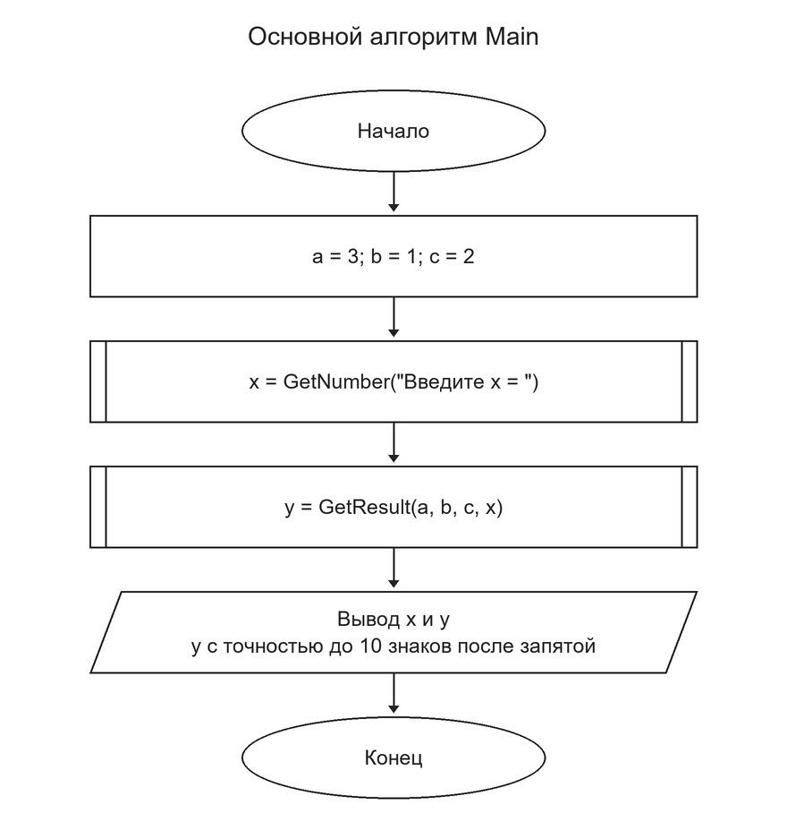

# Алгоритмизация и программирование

Практическая работа №1: **«Линейный вычислительный процесс»**.

В репозитории выполнено **задание 1.1, вариант №11**. Программа написана на C# и рассчитана на .NET 10.0.

## Условие

Вычислить значение функции при заданных константах `a`, `b`, `c` и значении `x`, введённом с клавиатуры. Вывести введённое значение и результат с пояснениями, проверить расчёт и составить блок-схему алгоритма.

$$
y = \frac{a x^2 + \frac{3}{5} b |x|}{c + \sqrt{x^2 + 4}}
$$

Константы: **a = 3, b = 1, c = 2**. Проверочное значение: **x = 2**.

## Запуск

### В Visual Studio

1. Установить Visual Studio с поддержкой C# и .NET 10.0.
2. Открыть решение [`Task 1/Task 1.sln`](<Task 1/Task 1.sln>).
3. Запустить проект **Task 1-1** сочетанием `Ctrl+F5`.
4. Ввести значение `x` и нажать `Enter`.

### В командной строке

Нужен **.NET SDK 10.0**. Выполнить из корня репозитория:

```shell
dotnet run --project "Task 1/Task 1-1/Task 1-1.csproj"
```

Ввод дробного числа поддерживает точку и запятую: `1.5` и `1,5` дают одинаковый результат. Как и в примере методички, предполагается корректный числовой ввод. Пустая строка и текст вместо числа вызовут ошибку преобразования.

## Проверочный результат

При `x = 2`:

$$
y = \frac{3 \cdot 2^2 + \frac{3}{5} \cdot 1 \cdot |2|}{2 + \sqrt{2^2 + 4}}
  = \frac{13{,}2}{2 + \sqrt{8}}
  \approx 2{,}7338095117.
$$

Программа выводит результат с десятью знаками после десятичного разделителя. Разделитель при выводе зависит от языковых настроек компьютера.

## Структура

| Файл | Содержание |
| --- | --- |
| [`Program.cs`](<Task 1/Task 1-1/Program.cs>) | Ввод данных, расчёт функции и вывод результата |
| [`Отчёт`](docs/report.md) | Условие, описание решения, расчёт и блок-схемы |
| [`Проверка`](docs/verification.md) | Сверка результатов и дополнительные значения x |
| [`Проверочный расчёт в Excel`](docs/verification.xlsx) | Изменяемые исходные данные и формулы |
| [`Оформление на GitHub`](docs/github-guide.md) | Создание issue, рабочей ветки и pull request |

Ввод и вычисление выделены в методы `GetNumber` и `GetResult`. Методы снабжены русскими XML-комментариями.

## Блок-схема основного алгоритма



Отдельные схемы ввода и вычисления приведены в [отчёте](docs/report.md). Результаты сборки и настройки редактора исключены из Git через `.gitignore`.

Источник условия: Филипченко М. А. «Методические указания к выполнению задания №1. Линейный вычислительный процесс», раздел 3.1, вариант №11, печатная страница 52.

Задание оформлено в [issue №1](https://github.com/nst080408/algorithmization-programming/issues/1). Рабочая ветка: `feature/1`.
