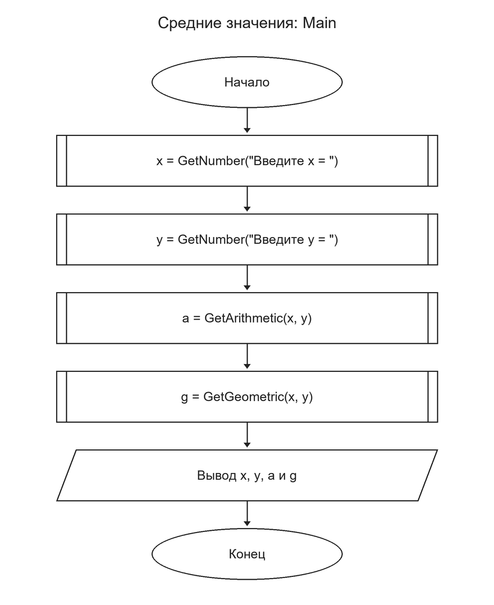
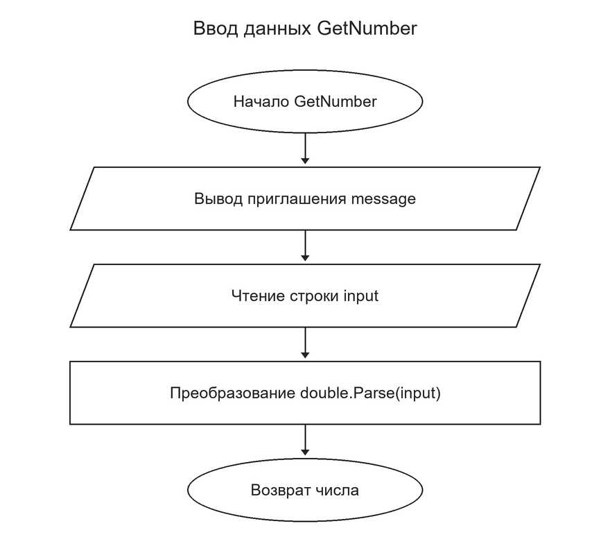
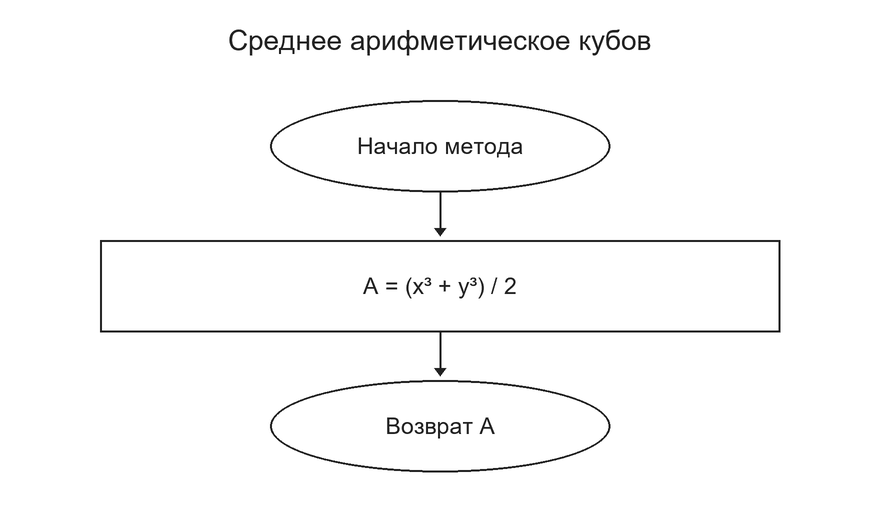
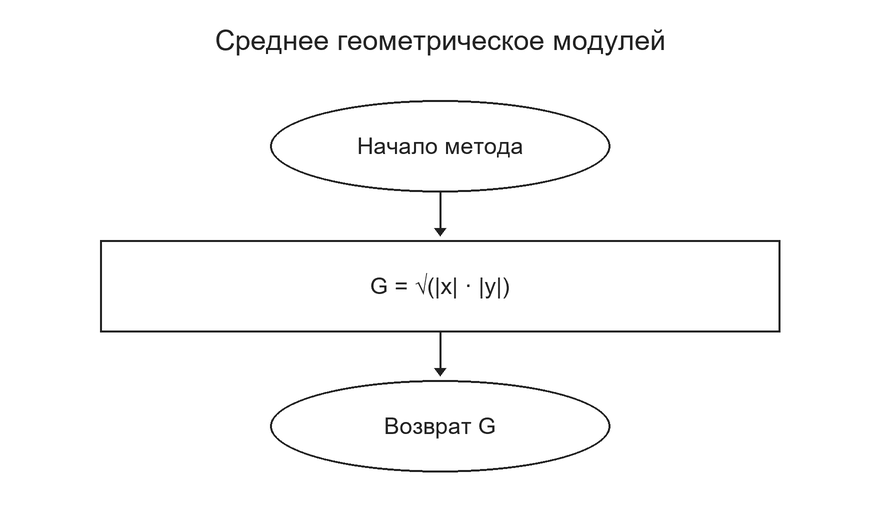

# Средние значения двух чисел

**Практическая работа №1. Задание 1.2. Вариант 11.**

## Условие

Даны два числа `x` и `y`. Найти среднее арифметическое их кубов и среднее геометрическое их модулей. Исходные данные вводит пользователь. Результаты вывести на экран с пояснениями.

## Формулы

$$
A = \frac{x^3 + y^3}{2}, \qquad G = \sqrt{|x| \cdot |y|}.
$$

Сначала каждое число возводится в куб, затем находится среднее двух полученных значений. Для геометрического среднего используются модули исходных чисел: произведение под корнем неотрицательно и при разных знаках `x` и `y`.

## Реализация

Проект: [`Task 1-2`](<../Task 1/Task 1-2/Task 1-2.csproj>). Исходный код: [`Program.cs`](<../Task 1/Task 1-2/Program.cs>).

Тип данных `double` позволяет работать с дробными числами. Метод `GetNumber` отвечает за ввод, `GetArithmetic` вычисляет `A`, а `GetGeometric` вычисляет `G`. Метод `Main` вызывает эти методы и выводит исходные числа и оба результата.

```csharp
return (x * x * x + y * y * y) / 2.0;
```

```csharp
return Math.Sqrt(Math.Abs(x) * Math.Abs(y));
```

Ввод выполняется через `double.Parse(input)`; десятичный разделитель определяется настройками Windows. Предполагаются корректные конечные числа умеренной величины, без переполнения при умножении. Ответ выводится без специального форматирования; точка или запятая определяется настройками компьютера.

## Контрольный пример

В качестве примера выбраны `x = -2`, `y = 8`. В условии фиксированных значений нет.

$$
A = \frac{(-2)^3 + 8^3}{2} = \frac{-8 + 512}{2} = 252;
\qquad G = \sqrt{|-2| \cdot |8|} = \sqrt{16} = 4.
$$

Ожидаемый вывод при десятичной точке:

```text
x = -2; y = 8
Среднее арифметическое кубов A = 252
Среднее геометрическое модулей G = 4
```

## Блок-схемы

### Основной алгоритм



### Ввод числа



### Вычисление среднего арифметического кубов



### Вычисление среднего геометрического модулей



Овал обозначает начало и завершение алгоритма, параллелограмм обозначает ввод или вывод, прямоугольник обозначает вычисление, прямоугольник с боковыми линиями обозначает вызов метода.

## Проверка

Результаты запусков и сравнение с независимым расчётом приведены в [проверке](verification-1-2.md).

## Вывод

По введённым значениям вычисляются два средних. Контрольный пример с числами разных знаков позволяет проверить возведение отрицательного числа в куб и использование модулей под квадратным корнем.

Источник: Филипченко М. А. «Методические указания к выполнению задания №1. Линейный вычислительный процесс», раздел 3.2, вариант 11, печатная страница 60 (61-я страница PDF).
