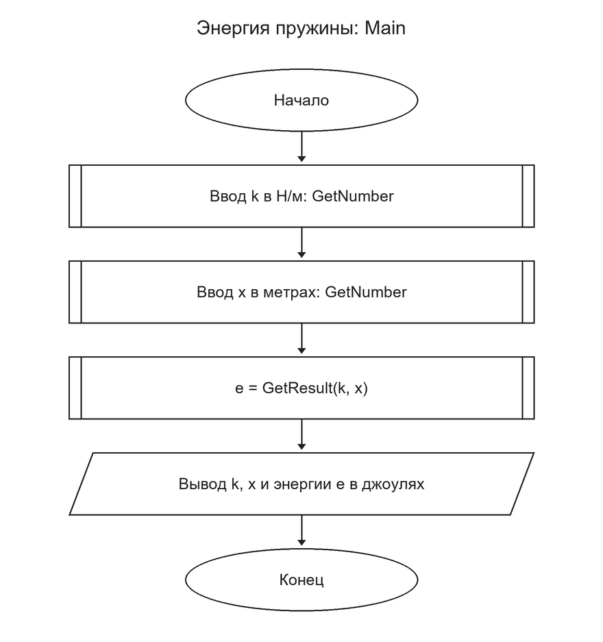
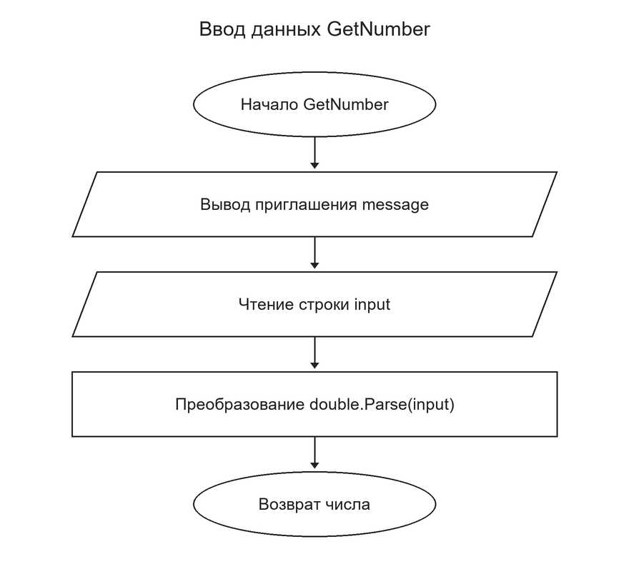
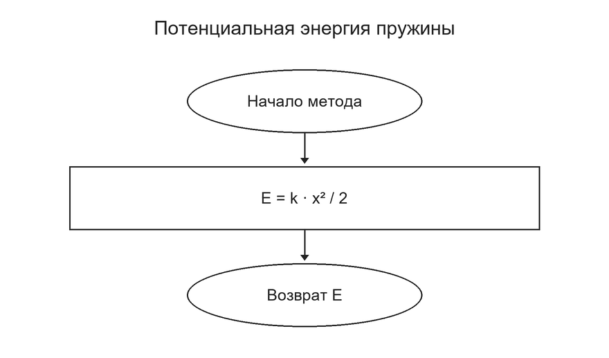

# Потенциальная энергия пружины

**Практическая работа №1. Задание 1.3. Вариант 11.**

## Условие

Определить потенциальную энергию пружины, растянутой на `x`, если коэффициент её жёсткости равен `k`. Исходные данные вводит пользователь. Результат вывести на экран с пояснениями.

## Формула и единицы измерения

$$
E = \frac{k x^2}{2}.
$$

Здесь `k` является жёсткостью пружины в Н/м, `x` является растяжением в метрах, а `E` является потенциальной энергией в джоулях. Формула применяется для упругой деформации пружины, подчиняющейся закону Гука.

Исходные данные: `k > 0`, `x >= 0`. Если растяжение известно в сантиметрах, перед вводом его нужно перевести в метры: например, `10 см = 0,1 м`.

## Реализация

Проект: [`Task 1-3`](<../Task 1/Task 1-3/Task 1-3.csproj>). Исходный код: [`Program.cs`](<../Task 1/Task 1-3/Program.cs>).

Для переменных используется тип `double`. Метод `GetNumber` считывает число, метод `GetResult` вычисляет энергию, а `Main` организует ввод, вычисление и вывод.

```csharp
return k * x * x / 2.0;
```

Результат выводится без специального форматирования. Ввод выполняется через `double.Parse(input)`; десятичный разделитель определяется настройками Windows. Предполагаются корректные конечные числовые данные умеренной величины, соответствующие условию. Проверка ограничений `k > 0`, `x >= 0` и обработка ошибочного ввода не выполняются.

## Контрольный пример

Для примера выбраны `k = 200 Н/м`, `x = 0,1 м`. В условии фиксированных числовых значений нет.

$$
E = \frac{200 \cdot 0{,}1^2}{2}
  = \frac{200 \cdot 0{,}01}{2}
  = 1\ \text{Дж}.
$$

Ожидаемый вывод при десятичной точке:

```text
k = 200 Н/м; x = 0.1 м
Потенциальная энергия E = 1 Дж
```

## Блок-схемы

### Основной алгоритм



### Ввод числа



### Вычисление энергии



Овал обозначает начало и завершение алгоритма, параллелограмм обозначает ввод или вывод, прямоугольник обозначает вычисление, прямоугольник с боковыми линиями обозначает вызов метода.

## Проверка

Результаты запусков и сравнение с независимым расчётом приведены в [проверке](verification-1-3.md).

## Вывод

По жёсткости и растяжению пружины рассчитывается её потенциальная энергия. Входные величины задаются в системе СИ, результат выражается в джоулях.

Источник: Филипченко М. А. «Методические указания к выполнению задания №1. Линейный вычислительный процесс», раздел 3.3, вариант 11, печатная страница 62 (63-я страница PDF).
