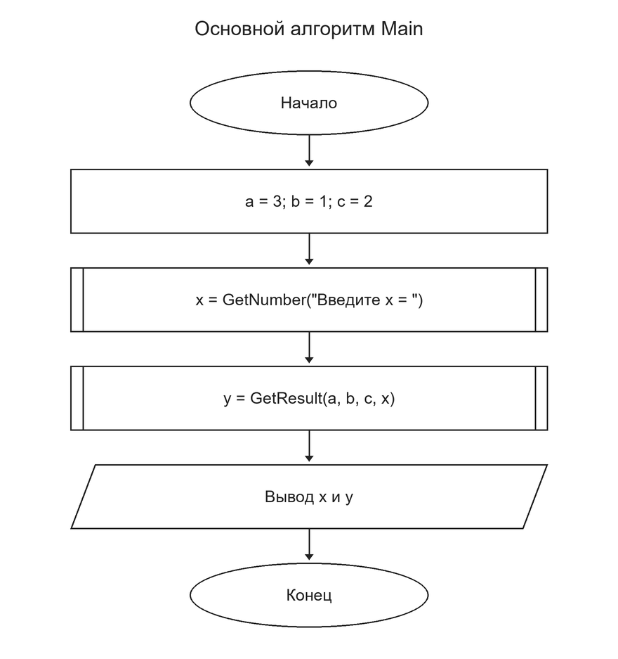
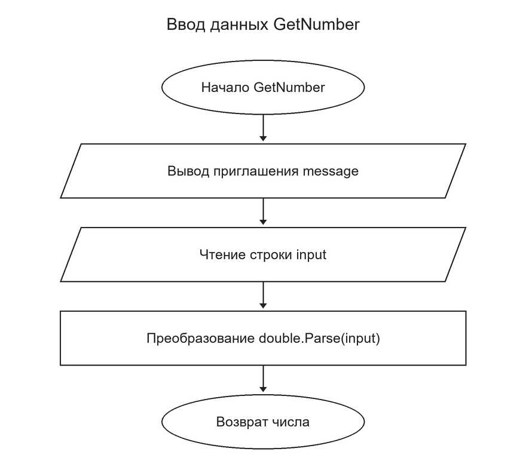
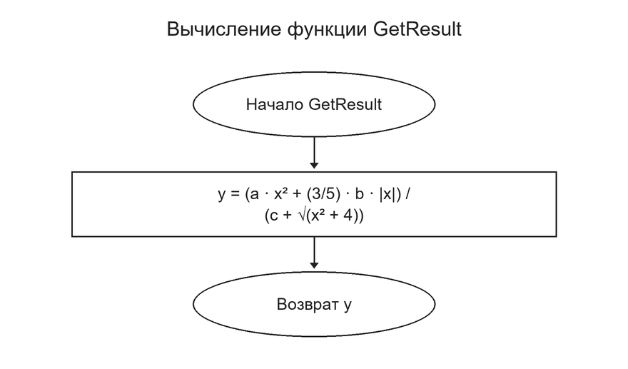

# Отчёт по заданию 1.1

**Дисциплина:** Алгоритмизация и программирование.  
**Тема:** Линейный вычислительный процесс.  
**Вариант:** 11.

## Цель работы

Изучить ввод и вывод данных в консольном приложении C#, работу с константами, вещественными числами и математическими функциями. Выделить ввод и расчёт в отдельные методы и составить блок-схемы алгоритма.

## Условие

Вычислить значение функции при заданных константах `a`, `b`, `c` и значении `x`, введённом с клавиатуры. Вывести значения `x` и `y` с поясняющими сообщениями. Сравнить результат с расчётом в Excel или на инженерном калькуляторе. Дополнить отчёт блок-схемой.

$$
y = \frac{a x^2 + \frac{3}{5} b |x|}{c + \sqrt{x^2 + 4}},
\qquad a = 3,\ b = 1,\ c = 2.
$$

Для проверки в таблице задано `x = 2`; в программе `x` вводится с клавиатуры.

## Данные и формула в C#

Для констант и переменных использован тип `double`, поскольку результат может быть дробным. Значения `a`, `b`, `c` объявлены с помощью `const`.

Расчёт записан непосредственно в методе `GetResult`:

```csharp
return (a * x * x + 3.0 / 5.0 * b * Math.Abs(x)) /
    (c + Math.Sqrt(x * x + 4));
```

`Math.Abs(x)` вычисляет модуль, `Math.Sqrt(...)` вычисляет квадратный корень. Дробь записана как `3.0 / 5.0`, чтобы избежать целочисленного деления: выражение `3 / 5` в C# дало бы ноль.

При `c = 2` знаменатель не обращается в ноль: для любого действительного `x` выполняется `2 + sqrt(x² + 4) >= 4`. Для вычислений в программе предполагаются конечные числа умеренной величины, которые не вызывают переполнения `double`.

## Структура программы

- `Main` задаёт константы, вызывает ввод и расчёт, выводит результат.
- `GetNumber` выводит приглашение и преобразует введённую строку в `double`. Десятичный разделитель определяется настройками Windows.
- `GetResult` принимает `a`, `b`, `c`, `x` и возвращает значение функции.

Алгоритм линейный: после ввода выполняются вычисление и вывод. Циклы и проверка условий для расчёта не нужны. Полный исходный код расположен в [`Program.cs`](<../Task 1/Task 1-1/Program.cs>).

## Проверочный расчёт

Для `x = 2`:

1. Квадрат аргумента: `x² = 4`.
2. Модуль аргумента: `|x| = 2`.
3. Числитель: `3 · 4 + (3/5) · 1 · 2 = 13,2`.
4. Знаменатель: `2 + sqrt(4 + 4) = 2 + sqrt(8) ≈ 4,82842712474619`.
5. Результат: `y ≈ 2,73380951166243`.

Ожидаемый вывод числового результата:

```text
x = 2; y = 2,7338095116624275
```

Программа выводит значение без специального форматирования. При английских настройках дробная часть отделяется точкой: `2.7338095116624275`. Подробная сверка, включая дополнительные значения аргумента, приведена в [проверке](verification.md).

## Блок-схемы

### Основной алгоритм Main



### Ввод данных GetNumber



### Вычисление функции GetResult



В схемах овал обозначает начало и конец, параллелограмм обозначает ввод или вывод, прямоугольник обозначает вычисление, прямоугольник с боковыми линиями обозначает вызов подпрограммы. Рядом с PNG сохранены исходные схемы в формате SVG.

## Вывод

Реализована программа вычисления функции для варианта №11. Ввод и расчёт выделены в отдельные методы, к методам добавлена документация. Для проверочного значения `x = 2` получено `y ≈ 2,7338095117`.

Источник: Филипченко М. А. «Методические указания к выполнению задания №1. Линейный вычислительный процесс», раздел 3.1, вариант №11, печатная страница 52.
